<div align="center">

# Commander 500 · Fantasy Store

Sistema da liga de **Commander 500** (Magic: The Gathering) da Fantasy Store: ranking da temporada,
estatísticas de comandantes, sorteio de mesas com timer ao vivo e área do lojista para conduzir as rodadas.

**🔗 [fantasy500.vercel.app](https://fantasy500.vercel.app)** · [Especificação](SPEC.md) · [Guia de desenvolvimento](docs/DESENVOLVIMENTO.md)


</div>

## O problema

A liga acontece em etapas na loja: os jogadores presentes são sorteados em mesas de 4, jogam com tempo marcado e o lojista
anota quem venceu. O sistema cuida do sorteio, da pontuação e da classificação e deixa o ranking
público para os jogadores acompanharem pelo celular.

## Funcionalidades

**Para os jogadores (site público, mobile-first)**
- Ranking da temporada e de cada etapa, com critérios de desempate configuráveis
- Mesas sorteadas e **timer ao vivo**, igual em todos os dispositivos (recarregar a página não reinicia o tempo)
- Estatísticas de comandantes (mais jogados, mais vitórias, % de vitória), com as artes vindas da API do **Scryfall**
- Hall da Fama com o pódio de cada temporada encerrada, regulamento da liga e tema claro/escuro

**Para o lojista (área administrativa com login)**
- Presença dos jogadores → **sorteio das mesas** → início da rodada → registro dos resultados → ranking atualizado
- Cadastro de jogadores e decks (o comandante é buscado no Scryfall), com aprovação das listas
- Configuração da pontuação por temporada, mesa final, fotos do top e cadastro de administradores

## Telas

### Rodada ao vivo
O lojista inicia a rodada e o timer aparece igual no telão da loja e no celular de cada jogador. A busca "Encontre sua mesa" leva o jogador direto à cadeira dele.

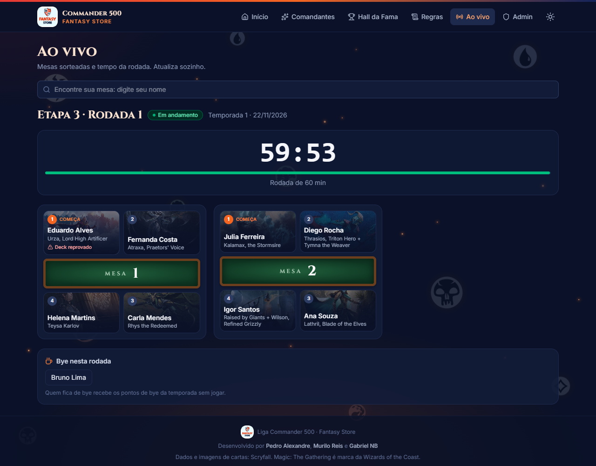

### Área do lojista
<table>
  <tr>
    <td width="50%">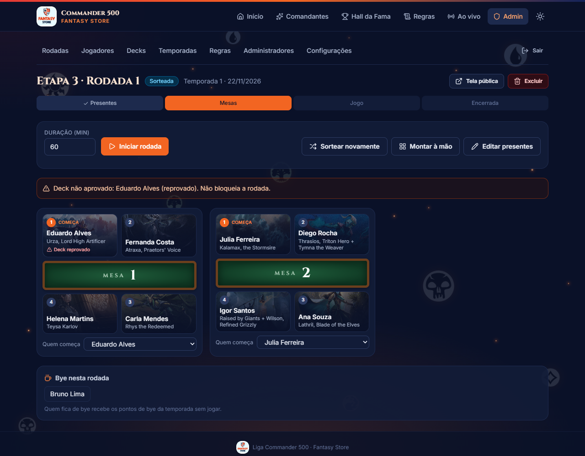<br><sub><b>Sorteio:</b> mesas com as cadeiras e quem começa, opção de sortear de novo ou montar à mão, bye e aviso de deck reprovado.</sub></td>
    <td width="50%">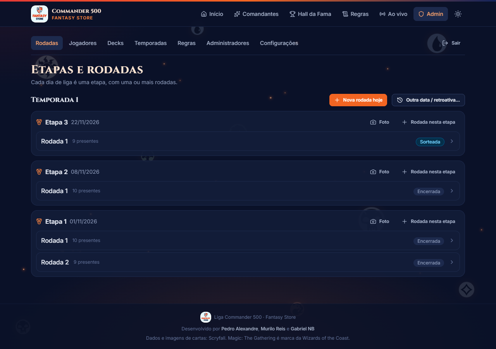<br><sub><b>Etapas e rodadas:</b> cada dia de liga é uma etapa, e dá para lançar rodadas retroativas.</sub></td>
  </tr>
  <tr>
    <td colspan="2">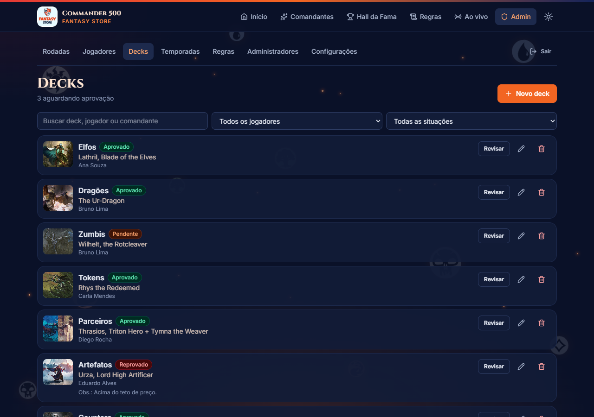<br><sub><b>Decks:</b> cadastro com o comandante buscado no Scryfall, aprovação e reprovação com observação.</sub></td>
  </tr>
</table>

### Site público
<table>
  <tr>
    <td width="50%">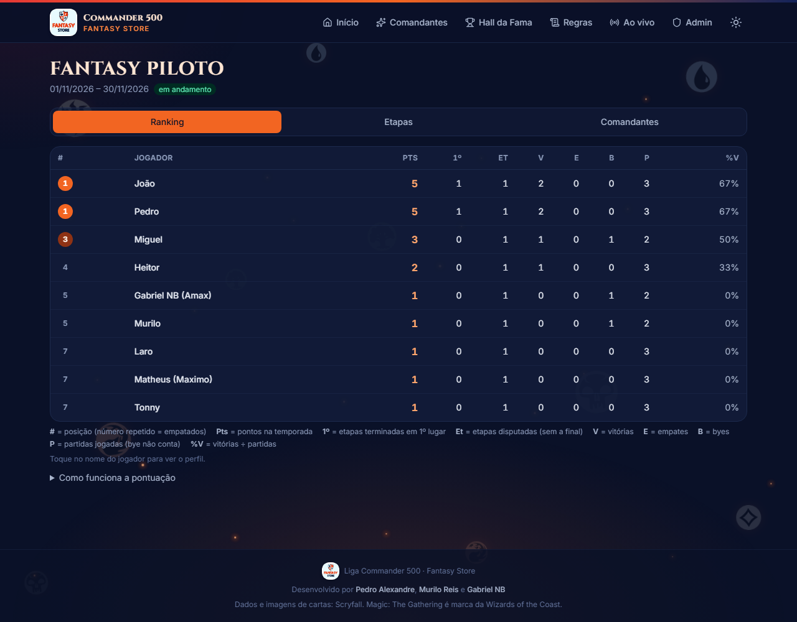<br><sub><b>Ranking da temporada:</b> calculado a cada requisição a partir dos resultados.</sub></td>
    <td width="50%">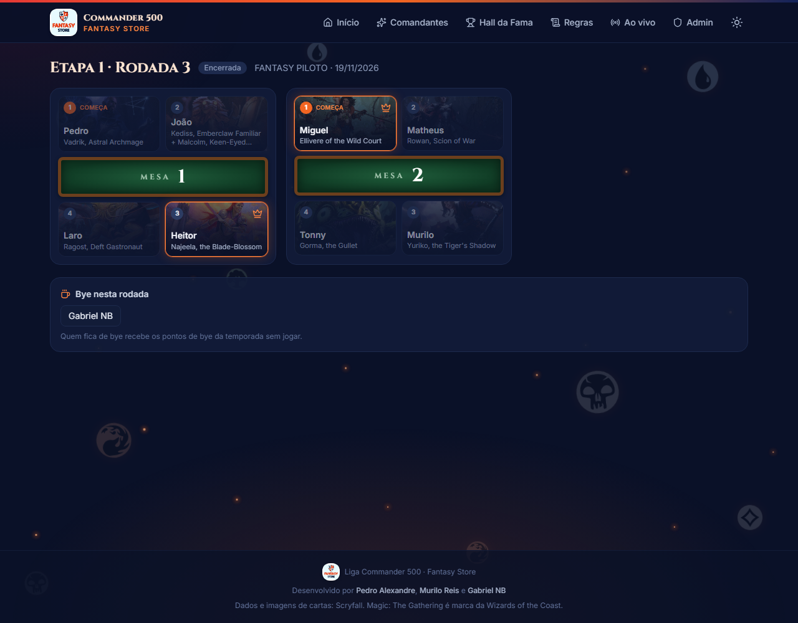<br><sub><b>Rodada encerrada:</b> a coroa marca o vencedor de cada mesa.</sub></td>
  </tr>
  <tr>
    <td>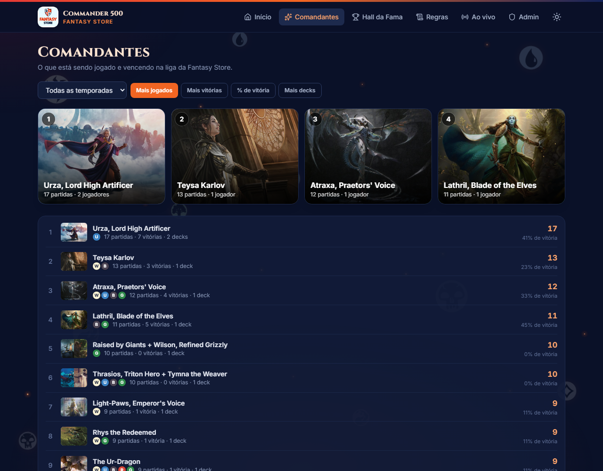<br><sub><b>Comandantes:</b> estatísticas com as artes do Scryfall.</sub></td>
    <td>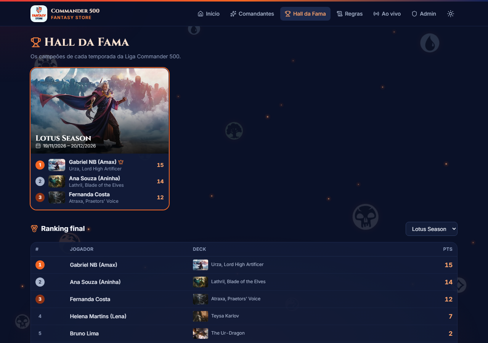<br><sub><b>Hall da Fama:</b> pódio e ranking final das temporadas encerradas.</sub></td>
  </tr>
</table>

### No celular
<p align="center">
  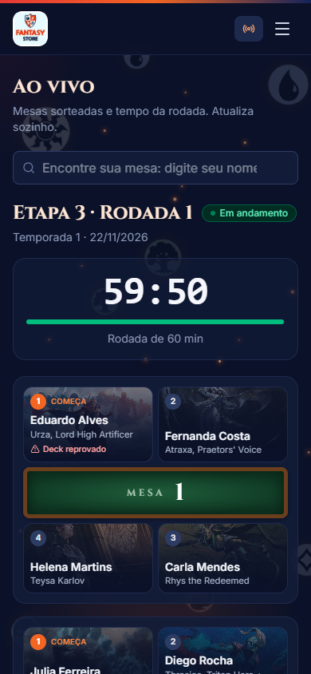
  &nbsp;
  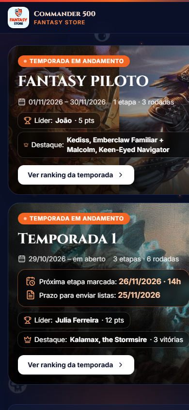
  &nbsp;
  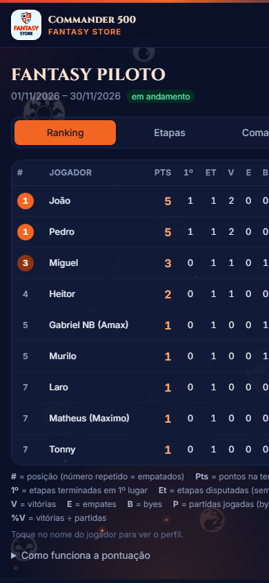
</p>

## Arquitetura

Arquitetura limpa em quatro projetos .NET. As regras de negócio ficam no Domínio como funções puras, sem depender de banco nem de framework, e por isso são fáceis de testar.

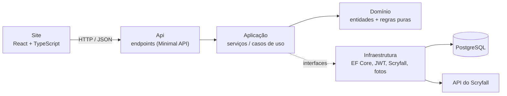

```
src/
  Commander500.Dominio/          entidades e regras (sorteio, ranking, estatísticas, fluxo da rodada)
  Commander500.Aplicacao/        serviços que carregam, chamam o domínio e salvam
  Commander500.Infraestrutura/   EF Core + PostgreSQL, JWT, cliente do Scryfall, armazenamento de fotos
  Commander500.Api/              endpoints públicos e do admin, tratamento de erros
tests/Commander500.Testes/       xUnit sobre as regras do domínio
web/                             React 19 + Vite + TypeScript + Tailwind + TanStack Query
```

## Decisões técnicas que valem destacar

- **Pontos nunca são gravados.** O ranking é recalculado a partir dos resultados e da configuração da temporada. Corrigir um resultado antigo corrige tudo sem precisar de migração de dados.
- **Sorteio justo:** Fisher–Yates com gerador criptográfico. Quando há bye, ele vai para quem teve menos byes na etapa e depois na temporada. Dentro da mesma etapa, o sorteio testa 300 arranjos e fica com o que menos repete adversários.
- **Timer sem WebSocket:** a rodada guarda só `IniciadaEm` (UTC) e a duração, e cada tela calcula o tempo restante. Todos os dispositivos mostram o mesmo tempo, e recarregar a página não reinicia nada.
- **Máquina de estados da rodada** (Rascunho → Sorteada → Em andamento → Encerrada), com as transições validadas no domínio.
- **Integração com o Scryfall** com cache e limite de requisições, além de uma rotina em segundo plano que completa a arte dos comandantes salvos enquanto a API estava fora.
- **Segurança:** JWT com verificação de que o administrador ainda existe a cada requisição, RLS ligado no Supabase e HTML do regulamento sanitizado com DOMPurify.
- **Código em português** (classes, tabelas, rotas e JSON), para que qualquer pessoa da equipe consiga depurar.

## Testes e publicação

- **Mais de 100 testes xUnit** cobrindo sorteio, ranking da etapa e da temporada, desempates, estatísticas de comandantes e fluxo da rodada.
- **CI/CD:** cada merge na `main` roda `dotnet test` e o build do site no GitHub Actions e, se tudo passar, publica na **Vercel**: o site e a Api (container Docker) ficam no mesmo domínio. O banco é PostgreSQL no **Supabase**.

## Rodando localmente

Pré-requisitos: .NET 9, Node 22 e Docker.

```bash
git clone https://github.com/opedroasa/commander-500.git
cd commander-500
dotnet tool restore
```

Abra `Commander500.sln` e aperte **F5** na `Commander500.Api`. Isso sobe o banco no Docker, a Api e o site, já com dados de exemplo.
Outras formas de rodar, endereços locais e solução de problemas estão no [guia de desenvolvimento](docs/DESENVOLVIMENTO.md).

## Equipe

| | |
|---|---|
| **Pedro Alexandre** ([@opedroasa](https://github.com/opedroasa)) | Desenvolvimento full stack: regras de negócio, back-end, front-end, visual e infraestrutura |
| **Murilo Reis** ([@MickeLike](https://github.com/MickeLike)) | Desenvolvimento full stack: regras de negócio, back-end, front-end, visual e infraestrutura |
| **Gabriel NB** | Ideias, testes e contato com o lojista |

Pedro e Murilo dividiram o código em todas as áreas, do domínio ao deploy.

---

<sub>Dados e imagens de cartas: [Scryfall](https://scryfall.com). Magic: The Gathering é marca da Wizards of the Coast. Projeto independente, sem vínculo com a Wizards.</sub>
